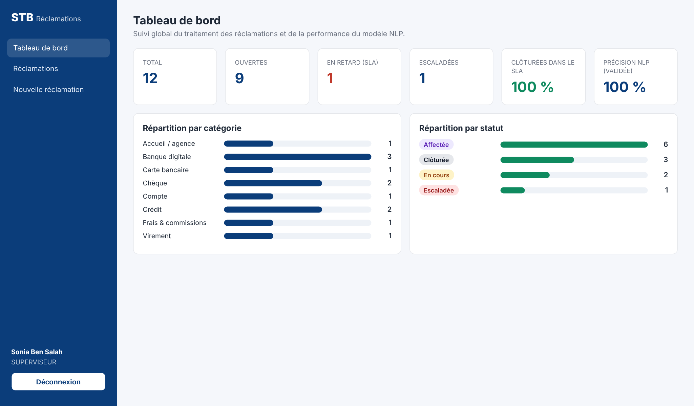

# STB Réclamations — Plateforme de gestion des réclamations clients

[](https://github.com/oujimalek/stb-reclamations/actions/workflows/ci.yml)

Workflow automatisé de traitement des réclamations et classification des tickets par NLP.
Projet de stage ingénieur — STB BANK, Direction Technique (juillet – septembre 2026).



## Architecture

| Dossier | Technologie | Port | Rôle |
|---|---|---|---|
| `backend/` | Java 17, Spring Boot 3.3, Spring Security (JWT), JPA | 8080 | API REST, moteur de workflow, SLA, affectation, escalade |
| `nlp-service/` | Python 3, scikit-learn, FastAPI | 8000 | Classification catégorie + priorité |
| `frontend/` | Angular 18 | 4200 | Portail client + back-office agents |

## Lancer le projet

### 1. Service NLP
```bash
cd nlp-service
pip install -r requirements.txt
python data/generate_dataset.py   # génère le corpus (déjà fourni)
python train.py                   # entraîne et évalue les modèles (déjà fournis dans models/)
uvicorn app:app --port 8000
```

### 2. Back-end
```bash
cd backend
mvn spring-boot:run                                   # base H2 en mémoire
mvn spring-boot:run -Dspring-boot.run.profiles=postgres  # PostgreSQL (base stb_reclamations)
```
Comptes de démonstration (mot de passe `Stb@2026`) :
`admin@stb.com.tn`, `superviseur@stb.com.tn`, `agent.monetique@stb.com.tn`, `agent.operations@stb.com.tn`, `agent.credit@stb.com.tn`, `agent.relation@stb.com.tn`.

### 3. Front-end
```bash
cd frontend
npm install
npm start        # http://localhost:4200  (portail client : /portail)
```

## Workflow d'une réclamation

`NOUVELLE → QUALIFIEE → AFFECTEE → EN_COURS → (EN_ATTENTE_CLIENT | ESCALADEE) → RESOLUE → CLOTUREE`
(+ `REJETEE`, réservé au superviseur). Les transitions sont contrôlées par `WorkflowEngine`.

- Classification NLP au dépôt ; si la confiance ≥ 0,45 : qualification et affectation automatiques à l'agent habilité le moins chargé.
- Échéance SLA : 24 h (haute), 72 h (moyenne), 120 h (basse).
- `EscaladeScheduler` escalade toutes les 15 minutes les réclamations en retard et alerte les superviseurs.

## Module NLP

TF-IDF (mots 1-2 grammes + caractères 3-5 grammes) et comparaison Naive Bayes / régression logistique / SVM linéaire.
Les métriques sont dans `nlp-service/models/metriques.json`. Le corpus est synthétique et anonyme (les réclamations réelles étant couvertes par le secret bancaire) ;
un second jeu rédigé à la main (`data/test_manuel.csv`) mesure la généralisation.

## Lancer avec Docker
```bash
docker compose up --build
```
Front-end : http://localhost:4200 · API : http://localhost:8080 · NLP : http://localhost:8000/docs

## Qualité et tests

| Composant | Outils | Contenu |
|---|---|---|
| Back-end | JUnit 5, Mockito, MockMvc, JaCoCo | Tests unitaires (workflow, dépôt et classification, affectation, JWT) et tests d'intégration de l'API (401, 403, 409, parcours complet) |
| Service NLP | pytest, TestClient | Prétraitement, API `/classify`, validation, garde-fous de non-régression sur les métriques du modèle |
| API | Postman | `docs/STB-Reclamations.postman_collection.json` : 10 requêtes avec assertions, à lancer dans le Runner |
| Intégration continue | GitHub Actions | À chaque push : `mvn verify` + couverture, `pytest`, build de production Angular |

```bash
cd backend && mvn verify              # tests + rapport de couverture (target/site/jacoco/index.html)
cd nlp-service && pip install -r requirements-dev.txt && pytest -v
```

## Méthode de travail
- Branche `main` protégée par la CI ; commits suivant la convention *Conventional Commits* (`feat`, `fix`, `test`, `ci`, `docs`).
- Itérations hebdomadaires avec démonstration à l'encadrant (voir le planning dans le rapport).
